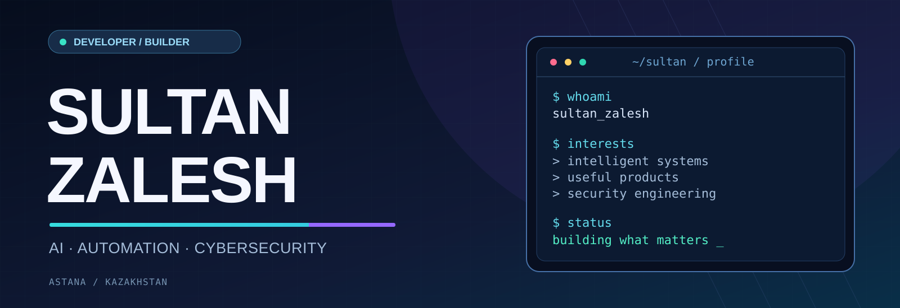
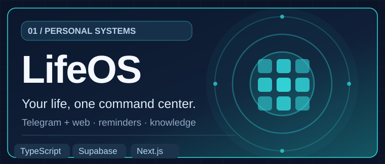
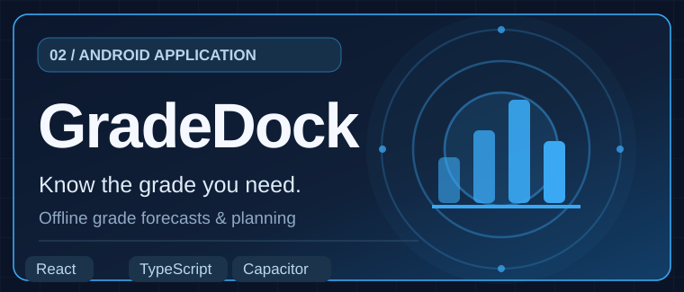
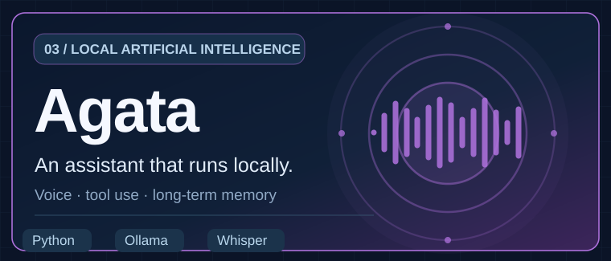
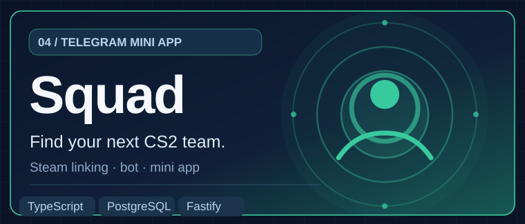

  

  <h3>Building useful software at the intersection of AI, automation & security.</h3>

  

    
    
  

### 👋 A little about me

I'm **Sultan Zalesh**, a **Cybersecurity student at Astana IT University** in Kazakhstan. I like turning complex ideas into practical software — from **local AI agents** and **Telegram automation** to **full-stack applications** and **Android tools**.

- 🧠 **AI & agents:** local LLMs, voice interfaces, tool calling and automation.
- 🛠️ **Product engineering:** web apps, bots, APIs and systems that solve real problems.
- 🛡️ **Security mindset:** exploring secure architectures, Linux and threat detection.
- 🌍 **Languages:** Kazakh · Russian · English.

### 🧰 Tools I build with

  

`Supabase` · `Fastify` · `Telegram Mini Apps` · `Ollama` · `Whisper` · `Capacitor` · `PostgreSQL`

### 🚀 Selected projects

<table>
  <tr>
    <td width="50%" valign="top">
      
      
A personal workspace spanning a Telegram bot, web dashboard, reminders, digests and knowledge workflows.

      
<a href="https://github.com/ZaleshSultan/lifeos"><b>Explore LifeOS →</b></a>

    </td>
    <td width="50%" valign="top">
      
      
Offline-first Android planner for weighted grades, target scores and remaining-assessment forecasts.

      
<a href="https://github.com/ZaleshSultan/gradedock"><b>Explore GradeDock →</b></a>

    </td>
  </tr>
  <tr>
    <td width="50%" valign="top">
      
      
Local Python AI assistant with speech recognition, a tool-calling loop and layered memory using Ollama.

      
<a href="https://github.com/ZaleshSultan/agata"><b>Explore Agata →</b></a>

    </td>
    <td width="50%" valign="top">
      
      
In-progress Telegram Mini App for finding CS2 teammates, with Telegram onboarding and Steam account linking.

      
<a href="https://github.com/ZaleshSultan/team"><b>Explore Squad →</b></a>

    </td>
  </tr>
</table>

### 🔐 More things I've worked on

- **[AI-powered Log Anomaly Detector](https://github.com/ZaleshSultan/aitu-hachaton)** — A hackathon project for analyzing suspicious web-server activity and sending Telegram alerts.
- **[AI Fitness Mentor](https://github.com/ZaleshSultan/fitness-mentor-bot)** — Telegram-based workout planning, nutrition tracking and AI-assisted coaching.
- **[Telegram Life OS Alert Bot](https://github.com/ZaleshSultan/tgpushalert)** — Deadline and reminder automation using Supabase, calendar feeds and Telegram.

### ⚡ How I like to work

> Build something useful. Make it understandable. Keep improving it.

I care about practical outcomes, maintainable architecture and learning by shipping real projects. I'm particularly interested in **AI products**, **developer tools**, **cybersecurity** and **automation**.

  Thanks for visiting — feel free to explore the code and get in touch through GitHub.

